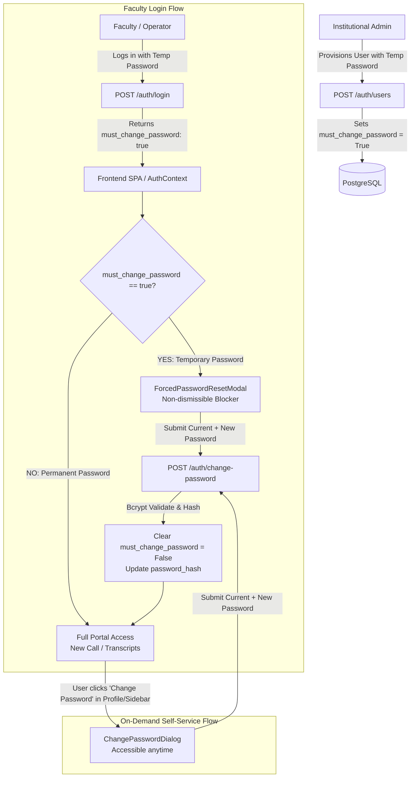

# Nirma AI Call Agent — Engineering Task Tracker & TODO Specification
# Document: TODO.md
# Classification: Architectural Roadmap & Security Engineering Specification
# Focus Area: Self-Service Password Management, Temporary Password First-Login Forced Reset & Credential Lifecycle

---

## 1. Executive Summary & Problem Context

### 1.1 Current Architecture & The Security Vulnerability
In the current Nirma Calling Assistant deployment:
1. **Admin Provisioning**: Institutional administrators create faculty/operator accounts via the **Faculty Access** interface (`POST /auth/users`). The admin manually supplies an initial password (e.g., a temporary institutional password like `Nirma@123` or generated alphanumeric string).
2. **Admin Password Reset**: Admins can reset any faculty member's password at any time using the Key icon in the Faculty Access table (`PATCH /auth/users/{user_id}`).
3. **The Critical Gap**:
   - There is **zero self-service password change mechanism** for logged-in faculty, operators, deans, or HODs.
   - In [`backend/api/auth.py`](file:///Users/urvagandhi/Developer/College/nirma-ai-call-agent/backend/api/auth.py), the only password update endpoint is locked behind `require_admin`.
   - In the frontend UI ([`Sidebar.tsx`](file:///Users/urvagandhi/Developer/College/nirma-ai-call-agent/frontend/src/components/Sidebar.tsx) and [`App.tsx`](file:///Users/urvagandhi/Developer/College/nirma-ai-call-agent/frontend/src/App.tsx)), operators only have access to *Calls & Transcripts* and *New Call*, with no profile settings or password change dialog.
   - **Consequence**: Temporary passwords provided by admins remain active indefinitely. Faculty members share temporary passwords over unencrypted email/Slack, creating severe credential leakage risks and violating enterprise higher-education compliance standards.

---

## 2. Proposed Architecture & System Design ("What We Have Thought Of")

To solve this completely and adhere to production-grade security standards, we have designed a **Dual-Mode Credential Management System**:



### 2.1 Mode 1: Mandatory First-Login Password Change (Temporary Password Flow)
- **Flagging**: When an admin provisions an account (`POST /auth/users`) or resets a user's password (`PATCH /auth/users/{user_id}`), the backend automatically flags the account with `must_change_password = True`.
- **Enforcement at Login**:
  - `POST /auth/login` returns `must_change_password: true` in the JSON response and embeds it as a claim in the signed JWT payload.
  - The frontend `AuthContext` detects `must_change_password === true`.
  - An unclosable, non-dismissible modal (`<ForcedPasswordResetModal />`) mounts immediately over the viewport. All navigation tabs, student directory search, and call initiation triggers are strictly blocked.
- **Resolution**:
  - The faculty member enters their temporary password (as `current_password`) and sets a new personal password conforming to institutional security policies.
  - Upon successful submission, the backend updates `password_hash`, clears `must_change_password = False`, issues fresh tokens, and unblocks the UI.

### 2.2 Mode 2: On-Demand Self-Service Password Change (Profile / Sidebar)
- **Accessibility**: Available to all authenticated users (both Admins and Faculty Operators).
- **UI Trigger**: A clean "Change Password" action integrated into the profile card in [`Sidebar.tsx`](file:///Users/urvagandhi/Developer/College/nirma-ai-call-agent/frontend/src/components/Sidebar.tsx) (desktop) and mobile top bar.
- **Security Safeguards**:
  - Requires entering `current_password` (prevents unauthorized password changes if a workstation is left unattended).
  - Enforces password complexity rules:
    - Minimum 8 characters, maximum 72 characters (Bcrypt truncation ceiling).
    - At least 1 uppercase letter, 1 lowercase letter, 1 number, and 1 special symbol (`@$!%*?&`).
    - New password **must not match** the current password.
  - Confirmation password validation (`new_password === confirm_password`).

### 2.3 Mode 3: Session Invalidation & Security Hardening
- **Token Invalidation**: When a user changes their password, all previous JWT refresh tokens stored in Redis (`user:session:{user_id}:refresh_tokens`) can be invalidated to terminate rogue sessions on other devices.
- **Brute-Force Rate Limiting**: Limit `/auth/change-password` to max 5 failed attempts per 15 minutes per IP/User to block brute-force attempts on `current_password`.
- **Audit Logging**: Every password change event must emit a structured security log entry:
  ```json
  {
    "event": "AUTH_PASSWORD_CHANGE",
    "user_id": 42,
    "user_email": "faculty@nirmauni.ac.in",
    "initiator": "self",
    "ip_address": "172.16.4.12",
    "timestamp": "2026-10-27T22:35:00Z",
    "status": "SUCCESS"
  }
  ```

---

## 3. Comprehensive Task Breakdown & Implementation Checklist

### Phase 1: Database Layer & Schema Migrations
- [ ] **`[DB-01]` Update `StaffUser` SQLAlchemy Model**
  - File: [`backend/database/models.py`](file:///Users/urvagandhi/Developer/College/nirma-ai-call-agent/backend/database/models.py)
  - Add `must_change_password: Mapped[bool] = mapped_column(Boolean, default=False, nullable=False)`
  - Add `password_updated_at: Mapped[Optional[datetime]] = mapped_column(DateTime(timezone=True), nullable=True)`
  - Document model attributes with Google-style docstrings.
- [ ] **`[DB-02]` Generate Alembic Migration Script**
  - File: `backend/database/migrations/versions/004_add_must_change_password_to_staff_users.py`
  - Implement `upgrade()`:
    - `op.add_column('staff_users', sa.Column('must_change_password', sa.Boolean(), server_default='false', nullable=False))`
    - `op.add_column('staff_users', sa.Column('password_updated_at', sa.DateTime(timezone=True), nullable=True))`
  - Implement `downgrade()` for clean rollbacks:
    - `op.drop_column('staff_users', 'password_updated_at')`
    - `op.drop_column('staff_users', 'must_change_password')`
  - Verify migration locally via `alembic upgrade head`.

---

### Phase 2: Backend Authentication & API Layer
- [ ] **`[API-01]` Create Pydantic Request & Response Schemas**
  - File: [`backend/api/auth.py`](file:///Users/urvagandhi/Developer/College/nirma-ai-call-agent/backend/api/auth.py)
  - Create `ChangePasswordRequest`:
    ```python
    class ChangePasswordRequest(BaseModel):
        current_password: str = Field(..., min_length=1, description="Existing temporary or current password")
        new_password: str = Field(..., min_length=8, max_length=72, description="New permanent password")
        confirm_password: str = Field(..., min_length=8, max_length=72, description="Confirmation of new password")

        @model_validator(mode="after")
        def validate_passwords(self) -> "ChangePasswordRequest":
            if self.new_password != self.confirm_password:
                raise ValueError("New password and confirm password do not match.")
            if self.new_password == self.current_password:
                raise ValueError("New password cannot be identical to the current password.")
            return self
    ```
  - Update `TokenResponse`: add `must_change_password: bool = False`.
  - Update `StaffUserResponse`: add `must_change_password: bool = False`.
- [ ] **`[API-02]` Implement `POST /auth/change-password` Endpoint**
  - File: [`backend/api/auth.py`](file:///Users/urvagandhi/Developer/College/nirma-ai-call-agent/backend/api/auth.py)
  - Route handler:
    ```python
    @router.post("/change-password", response_model=TokenResponse)
    async def change_password(
        payload: ChangePasswordRequest,
        current_user: StaffUser = Depends(get_current_user),
        session: AsyncSession = Depends(get_async_session),
    ) -> TokenResponse: ...
    ```
  - Logic:
    1. Verify `verify_password(payload.current_password, current_user.password_hash)`. If invalid, raise HTTP 400 (`"Current password does not match our records."`).
    2. Check password complexity regex (uppercase, lowercase, number, symbol).
    3. Compute `new_hash = get_password_hash(payload.new_password)`.
    4. Update `current_user.password_hash = new_hash`, `current_user.must_change_password = False`, and `current_user.password_updated_at = utc_now()`.
    5. Commit to PostgreSQL.
    6. Generate fresh access and refresh JWT tokens so user remains logged in without re-authenticating.
    7. Emit structured security audit log.
- [ ] **`[API-03]` Update Existing Admin User Provisioning & Reset Handlers**
  - File: [`backend/api/auth.py`](file:///Users/urvagandhi/Developer/College/nirma-ai-call-agent/backend/api/auth.py)
  - In `create_user` (`POST /auth/users`): Set `must_change_password=True` on initial creation so new faculty are always forced to reset on first login.
  - In `update_user` (`PATCH /auth/users/{user_id}`): If `payload.password` is provided (admin resets faculty password), automatically flip `user.must_change_password = True`.
- [ ] **`[API-04]` Embed `must_change_password` in JWT Claims & Login Output**
  - Update `create_jwt_token()` to optionally embed `"must_change_password"` in token claims.
  - Update `/auth/login` and `/auth/refresh` to return `must_change_password: user.must_change_password`.

---

### Phase 3: Frontend Client & State Management
- [ ] **`[FE-01]` Extend API Client Types & Endpoints**
  - File: [`frontend/src/lib/api-client.ts`](file:///Users/urvagandhi/Developer/College/nirma-ai-call-agent/frontend/src/lib/api-client.ts)
  - Update `StaffUser` and `StoredTokens` interfaces to include `must_change_password?: boolean`.
  - Add API function:
    ```typescript
    export async function changePassword(payload: {
      current_password: string;
      new_password: string;
      confirm_password: string;
    }): Promise<StoredTokens> {
      const data = await request<StoredTokens>('/auth/change-password', {
        method: 'POST',
        body: JSON.stringify(payload),
      });
      saveStoredTokens(data);
      return data;
    }
    ```
- [ ] **`[FE-02]` Update Authentication Context**
  - File: [`frontend/src/lib/auth-context.tsx`](file:///Users/urvagandhi/Developer/College/nirma-ai-call-agent/frontend/src/lib/auth-context.tsx)
  - Expose `mustChangePassword: boolean` in `AuthContextValue`.
  - Add `setMustChangePassword(val: boolean)` to clear the state immediately upon successful password change.

---

### Phase 4: Frontend UI / UX Components (Design System & Accessibility)
- [ ] **`[UI-01]` Create Reusable `ChangePasswordDialog.tsx` Component**
  - File: `frontend/src/components/ChangePasswordDialog.tsx`
  - Built with official Shadcn UI primitives (`@/components/ui/dialog`, `@/components/ui/input`, `@/components/ui/button`).
  - Inputs:
    - Current Password (with eye toggle for show/hide)
    - New Password (with eye toggle)
    - Confirm Password (with eye toggle)
  - Real-time password strength meter / requirements checklist:
    - Min 8 characters
    - At least 1 uppercase letter
    - At least 1 number
    - At least 1 special symbol
    - Passwords match indicator
  - Submit button states: disabled while requirements unmet or network request is in-flight.
  - Toast feedback via `sonner`: `toast.success("Password updated successfully")`.
- [ ] **`[UI-02]` Create `ForcedPasswordResetModal.tsx` Component**
  - File: `frontend/src/components/ForcedPasswordResetModal.tsx`
  - Mounts when `user.must_change_password === true`.
  - Backdrop is persistent (`onPointerDownOutside={(e) => e.preventDefault()}` and `onEscapeKeyDown={(e) => e.preventDefault()}`).
  - Welcoming yet mandatory institutional copy:
    > **"Set Permanent Account Password"**  
    > *"Welcome to the Nirma University Calling Assistant. You have logged in using an administrative temporary password. To protect institutional and student data, please set a personal, secure password before continuing."*
  - Reuses password strength validation and executes `changePassword()`.
- [ ] **`[UI-03]` Integrate into Sidebar & App Root**
  - File: [`frontend/src/components/Sidebar.tsx`](file:///Users/urvagandhi/Developer/College/nirma-ai-call-agent/frontend/src/components/Sidebar.tsx)
  - Add a "Change Password" action button in the desktop profile card (under role and scope badges) with a Key icon.
  - Add an identical icon button on the mobile header next to the logout button.
  - File: [`frontend/src/App.tsx`](file:///Users/urvagandhi/Developer/College/nirma-ai-call-agent/frontend/src/App.tsx)
  - Conditionally render `<ForcedPasswordResetModal />` at the root of `AuthenticatedApp` whenever `mustChangePassword === true`.

---

### Phase 5: Automated Testing, Security & Quality Assurance
- [ ] **`[TEST-01]` Unit Tests for Password Verification & Complexity**
  - File: [`backend/tests/unit/test_security_auth.py`](file:///Users/urvagandhi/Developer/College/nirma-ai-call-agent/backend/tests/unit/test_security_auth.py)
  - Test valid vs invalid password complexity rules.
  - Test prevention of identical password reuse.
- [ ] **`[TEST-02]` Integration Tests for Endpoints**
  - File: [`backend/tests/api/test_api_auth.py`](file:///Users/urvagandhi/Developer/College/nirma-ai-call-agent/backend/tests/api/test_api_auth.py)
  - `test_change_password_success`: Verifies valid credentials update hash in DB and return valid JWT.
  - `test_change_password_wrong_current`: Verifies HTTP 400 when old password doesn't match.
  - `test_change_password_same_as_old`: Verifies rejection when new password == old password.
  - `test_change_password_mismatched_confirm`: Verifies HTTP 422 when confirm != new.
  - `test_forced_reset_lifecycle`:
    1. Admin creates user -> `must_change_password == True`.
    2. User logs in -> `must_change_password == True`.
    3. User changes password -> `must_change_password == False`.
    4. Subsequent login returns `must_change_password == False`.
    5. Admin resets user password -> `must_change_password` flips back to `True`.
- [ ] **`[TEST-03]` Frontend Build & Typecheck**
  - Execute `npm run build` and `tsc -b` inside `frontend/` to ensure zero compilation or type regressions.

---

## 4. Architectural Rules & Compliance Matrix

| Regulation / Standard | Requirement | Implementation Detail |
| :--- | :--- | :--- |
| **TRAI / Telecom Security** | Protect student contact records from unauthorized operator access | Temporary credentials cannot be used indefinitely; forced change isolates account ownership to the specific faculty member. |
| **Bcrypt Standards** | Max 72-byte truncation boundary | Pydantic constraint `max_length=72` on all password inputs to prevent silent bcrypt truncation. |
| **Audit Trails** | Complete attribution of credential lifecycle | Structured logging of password updates with user ID and client IP, with zero plain-text password leakage. |
| **DESIGN.md Tokens** | Seamless visual integration | Strict derivation of modal surfaces from Canvas Elevated (`#131B2E`), Primary Terracotta (`#E06D3B`), and Hairline borders (`rgba(255,255,255,0.08)`). |

---

## 5. Execution Status Summary

| Task Category | Total Tasks | Completed | In Progress | Pending |
| :--- | :---: | :---: | :---: | :---: |
| **Phase 1: Database & Migrations** | 2 | 0 | 0 | 2 |
| **Phase 2: Backend API Layer** | 4 | 0 | 0 | 4 |
| **Phase 3: Frontend Client** | 2 | 0 | 0 | 2 |
| **Phase 4: Frontend UI / UX** | 3 | 0 | 0 | 3 |
| **Phase 5: Automated Testing** | 3 | 0 | 0 | 3 |
| **Total** | **14** | **0** | **0** | **14** |
