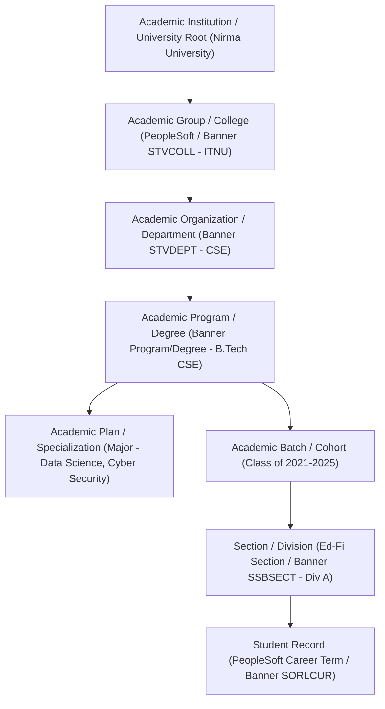
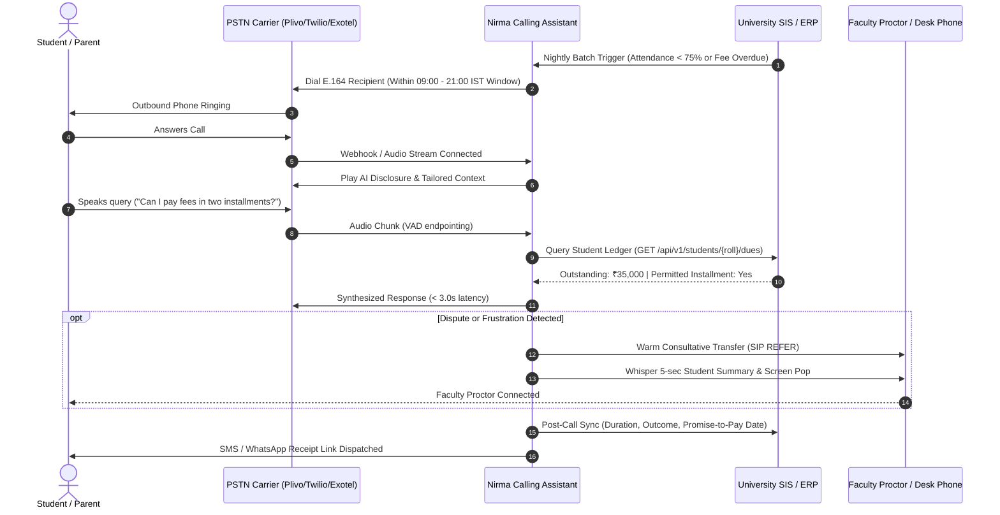
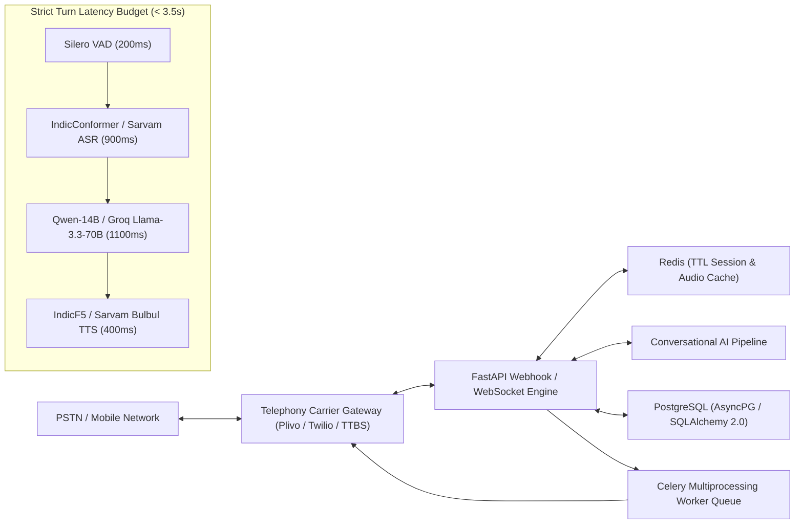
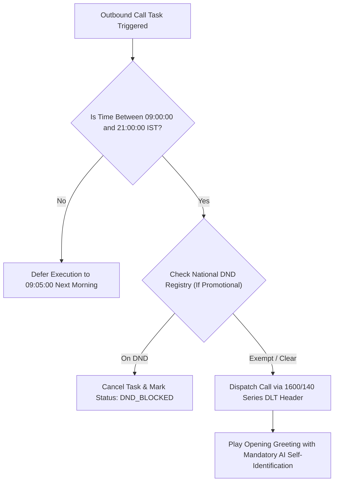
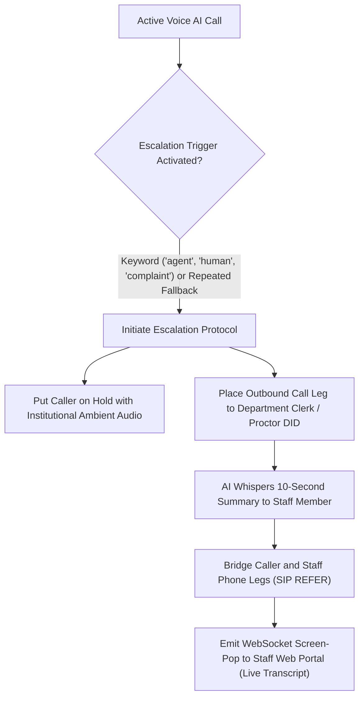

# Enterprise Voice AI in Higher Education: Architecture, Standards & Regulatory Blueprint
**Document Reference:** `docs/ENTERPRISE_HIGHER_ED_VOICE_AI_BLUEPRINT.md`  
**System:** Nirma Calling Assistant  
**Author:** Lead Distributed Systems Architect & Voice AI Specialist  
**Date:** October 2026  
**Status:** Approved Architectural Specification  

---

## 1. Executive Summary & Industry Context

Higher Education Institutions (HEIs) operate across distinct cyclical peaks—admissions counseling surges, semester fee payment deadlines, end-semester examination hall ticket verifications, and campus placement drives. During these peak intervals, traditional administrative desks encounter severe operational bottlenecks, high parent/student call abandonment rates, and delayed communication cycles.

Legacy Interactive Voice Response (IVR) systems relying on rigid Dual-Tone Multi-Frequency (DTMF) keypresses fail because students and parents have dynamic, multi-turn, multilingual queries. Modern **AI Voice Calling Assistants** resolve this challenge by uniting:
1. **Low-latency Telephony Carrier Integrations** (SIP Trunking, WebSockets, Plivo, Twilio, Exotel, TTBS Smartflo).
2. **Sub-4.0-Second Turn Pipelines** (Streaming STT $\rightarrow$ Quantized/Cached LLM $\rightarrow$ Neural Indic TTS).
3. **Deep University ERP/SIS Connectors** (PeopleSoft Campus Solutions, Ellucian Banner, Ed-Fi UDM, TCS iON, SAP SLCM).
4. **Strict TRAI / Telecom Regulatory Compliance** (India TCCCPR 2018: 09:00–21:00 IST calling windows, mandatory AI disclosure, DLT headers, 140/160 series numbering).
5. **Human-in-the-Loop (HITL) Warm Desk Escalation** with real-time screen-pop transcripts.

---

## 2. Higher Education Student Information System (SIS) Standards

Global enterprise SIS platforms model universities as hierarchical entities to support multi-college accreditation, degree audits, and role-based data partitioning.



### 2.1 Comparative Industry Architecture Matrix
| Concept | Oracle PeopleSoft Campus Solutions | Ellucian Banner (XE/LCUR) | Ed-Fi Alliance UDM | Nirma Calling Assistant |
| :--- | :--- | :--- | :--- | :--- |
| **University Root** | `Academic Institution` | `Institution` | `EducationOrganization (SEA/LEA)` | `institutions` |
| **Constituent College** | `Academic Group` | `College (STVCOLL)` | `PostsecondaryInstitution` | `institutes` |
| **Department** | `Academic Organization` | `Department (STVDEPT)` | `Department (OrganizationUnit)` | `departments` |
| **Degree Program** | `Academic Program` | `Program / Degree (STVDEGC)`| `Program / CourseCatalog` | `academic_programs` |
| **Specialization/Major**| `Academic Plan` | `Major / Field of Study (STVMAJR)`| `AcademicSubjectDescriptor` | `specialization` |
| **Admission Cohort** | `Academic Career / Term` | `Catalog Year / Cohort` | `Cohort (StudentCohortAssociation)` | `academic_batches` |
| **Class Section** | `Class Section` | `Course Section (SSBSECT)` | `Section (CourseOffering)` | `academic_divisions` |
| **Student Record** | `Student Career Term` | `Curriculum (SORLCUR / SORLFOS)` | `Student (StudentSectionAssociation)` | `students` |

---

## 3. Core Higher Education Voice AI Workflows



### 3.1 Semester Fee Payment Reminders & Financial Workflows
* **Cadence Engine**: Triggered automatically from the ERP accounting ledger at scheduled intervals:
  * $T-7$ Days: Courtesy reminder of due date.
  * $T-2$ Days: Urgent reminder with payment instructions.
  * Day 0: Deadline notice.
  * $T+3$ Days: Overdue alert regarding registration hold penalties.
* **No Voice Payment Policy**: In compliance with PCI-DSS and telecom regulations, the AI **never collects credit/debit card numbers or UPI PINs over the voice call**. Upon caller consent, the system dispatches an instant transactional SMS/WhatsApp message containing an authenticated UPI Intent / payment link (Razorpay, BillDesk, HDFC EduQfix).

### 3.2 Examination Hall Ticket & Attendance Shortage Alerts
* **Regulatory Context**: UGC, AICTE, and university regulations mandate a minimum of 75% or 80% lecture attendance to be eligible for end-semester examinations.
* **Early Warning Workflow**: When mid-semester attendance drops below 75% in specific subjects, the assistant calls the student and parent, identifies the short courses (e.g., *Operating Systems: 64%*), and details the procedural remedy (e.g., *Submit medical documentation to HOD by Thursday 5:00 PM*).
* **Mentor Booking**: If the parent disputes the record, the bot schedules an appointment with the assigned faculty mentor.

### 3.3 Admissions, Counseling & Enrollment ("Summer Melt" Prevention)
* **Speed-to-Lead Follow-up**: Prospective applicants filling inquiry forms on the university admissions portal receive an automated call within 60 seconds to assess entrance percentiles (GUJCET, JEE, CAT), confirm branch interest, and book on-campus counseling sessions.
* **Conversion Impact**: Proven in higher-ed case studies (e.g., Georgia State University) to reduce summer melt by over 21% among admitted students.

### 3.4 Campus Placement Drive Briefings (Training & Placement Cell)
* **Shortlist Briefings**: When corporate recruiters (e.g., TCS, Microsoft, L&T) release interview shortlists, the voice assistant calls candidates to convey reporting times, venue/video links, dress code requirements, and necessary documentation (resumes, grade sheets).
* **Live Verbal RSVP**: Records candidate confirmation ("Attending" vs "Opted out"), updating the Placement Coordinator's dashboard in real time.

---

## 4. End-to-End Technical Telephony Architecture

The Nirma Calling Assistant utilizes an asynchronous, event-driven telephony architecture designed for **sub-4.0-second turn turnaround**:



### 4.1 Strict Turn Latency Budget Allocation (< 4.0s Total)
| Pipeline Stage | Target Latency | Primary Engine | Fallback Engine | Optimization Strategy |
| :--- | :---: | :--- | :--- | :--- |
| **VAD & Endpointing** | **150 – 300 ms** | Silero VAD (Local CUDA/CPU) | Energy-based VAD | Silence detection threshold = 400ms; drops playback on barge-in. |
| **Speech-to-Text (STT)**| **700 – 1,100 ms** | IndicConformer 0.60B (AI4Bharat) | Sarvam AI (`saaras:v4`) | `multipart/form-data` raw wav stream; optimized Indic acoustic models. |
| **LLM Reasoning** | **800 – 1,400 ms** | Qwen-14B-Chat (Ollama Q4_K_M) | Groq Cloud (`llama-3.3-70b`) | Restrict output to $\le 35$ words (2 short sentences). Context pruned to last 6 turns. |
| **Text-to-Speech (TTS)**| **300 – 600 ms** | IndicF5 / Kokoro-82M | Sarvam AI (`bulbul:v2`) | Streaming 16-bit PCM 8kHz; pre-synthesize initial greetings. |
| **Transport & Caching**| **150 – 300 ms** | Redis Audio Cache (`TTL=300s`) | Nginx Static Reverse Proxy | Pre-warmed audio URLs served directly from in-memory cache. |
| **Total Turn Latency** | **2.1 – 3.7 s** | **Fully compliant with human conversational tolerance budget** | | |

---

## 5. Multilingual Indic Capabilities (English, Hindi, Gujarati)

Indian higher education environments require fluid handling of regional languages and code-mixed vernacular (Hinglish, Gujlish):
1. **Code-Mixed Language Support**:
   * Students and parents frequently communicate using mixed vocabulary:
     * *Hindi/English*: *"Mera semester fee receipt student portal pe show nahi ho raha hai."*
     * *Gujarati/English*: *"Mara attendance ma issue che, to HOD sir no contact number malse?"*
   * Standard global models (e.g. baseline Whisper) hallucinate or misclassify code-mixed Indic audio as English. The system deploys **Sarvam AI (`saaras:v4`)** and **AI4Bharat (`IndicConformer`)**, which are trained on extensive Indian telephony datasets.
2. **Inverse Text Normalization (ITN)**:
   * Telephony TTS engines stumble on numerical data, roll numbers, and currency symbols.
   * Dedicated regex normalization rules convert:
     * `₹35,000` $\rightarrow$ *"Pantees hazaar rupaye"* (Hindi) or *"Pootrees hajar rupiya"* (Gujarati).
     * `21BCE045` $\rightarrow$ *"Two One B C E Zero Four Five"*.

---

## 6. Telecom Regulatory Authority of India (TRAI) Compliance Framework

All automated telecalling operations within the Indian telecom circle must strictly adhere to the **Telecom Commercial Communications Customer Preference Regulations (TCCCPR, 2018)**:



### 6.1 Regulatory Compliance Invariants
1. **Mandatory Calling Window (09:00 to 21:00 IST)**:
   * The scheduler enforces that automated calls execute strictly within **09:00:00 to 21:00:00 Indian Standard Time (`Asia/Kolkata`)**. Tasks scheduled outside this window are automatically deferred.
2. **Mandatory Automated AI Disclosure**:
   * Consumer protection standards mandate that the opening line of every call explicitly states the caller's identity as an automated AI system of Nirma University:
     * *English*: *"Hello, this is an automated AI calling assistant from Nirma University..."*
     * *Hindi*: *"Namaste, main Nirma University ka automated AI calling assistant bol raha hoon..."*
     * *Gujarati*: *"Namaste, hu Nirma University no automated AI calling assistant chu..."*
3. **DLT Header & Number Allocation**:
   * Automated calling requires registration on Distributed Ledger Technology (DLT) portals (Vilpower, PingConnect, Jio DLT).
   * Transactional university service calls utilize **160/1600 series** numbers; promotional outreach uses **140 series**. Personal 10-digit SIM cards are strictly prohibited.
4. **National Do Not Disturb (DND / NCPR) Scrubbing**:
   * Promotional campaigns (admissions counseling marketing) must scrub recipient numbers against the national DND database before dispatch. Transactional calls (admitted student fee reminders, exam notices) are exempt under existing university enrollment relationship rules.
5. **Rate Limiting & Anti-Spam Throttling**:
   * Concurrency is throttled to a maximum of **10 concurrent calls per carrier trunk** to avoid overloading carrier switches or triggering telecom spam detection algorithms.

---

## 7. Human-in-the-Loop (HITL) & Consultative Desk Escalation

When an interaction involves complex financial disputes, mental health distress, or explicit requests for human assistance, the system transfers the call to a human faculty member or administrative clerk:



* **Warm / Consultative Transfer**: The AI places the caller on hold, dials the department office, whispers an audio briefing (*"Transferring student Urva Gandhi regarding OS attendance shortage (68%)"*), bridges the two phone lines, and disconnects.
* **Real-Time Screen Pop**: Concurrently, the frontend mission control interface receives a WebSocket event displaying the student's complete conversational transcript and academic standing.

---

## 8. Remote Supercomputer (HPC) Deployment Architecture

The Nirma Calling Assistant is engineered for local-first development and remote promotion to the **Nirma University Supercomputer** via SSH:

```
+-----------------------------------------------------------------------------------+
|                        NIRMA SUPERCOMPUTER NODE (HPC)                             |
|                                                                                   |
|  [Nginx Reverse Proxy (TLS)] ──> [FastAPI Web & WebSocket Engine (Port 8000)]     |
|                                         │                                         |
|                 ┌───────────────────────┴───────────────────────┐                 |
|                 ▼                                               ▼                 |
|      [Celery Worker Cluster]                         [FastAPI Async State Engine]  |
|      - NullPool Sync DB Engine                       - AsyncSession DB Engine     |
|      - Direct Sync Carrier SDK                       - Non-blocking Threadpool    |
|      - Rate-Limited Batch Dispatch                   - Redis TTL Session Store    |
|                 │                                               │                 |
|                 └───────────────────────┬───────────────────────┘                 |
|                                         ▼                                         |
|                          [24GB VRAM GPU Acceleration]                             |
|          - IndicConformer 0.60B STT (NeMo CUDA): ~1.5 GB VRAM                     |
|          - Qwen-14B-Chat (Ollama 4-bit Q4_K_M):  ~9.2 GB VRAM                     |
|          - IndicF5 / Kokoro-82M TTS:             ~2.0 GB VRAM                     |
|          - CUDA KV Cache & Context Buffers:      ~2.5 GB VRAM                     |
|          ----------------------------------------------------                     |
|          Total VRAM Footprint: ~15.2 GB (Safely within 24 GB RTX 3090/4090 budget)|
|                                                                                   |
|  [Failover Circuit Breakers]                                                      |
|  - STT: Local IndicConformer (Timeout 2.0s) -> Sarvam AI `saaras:v4` Cloud API     |
|  - LLM: Local Qwen-14B (Timeout 3.5s)       -> Groq `llama-3.3-70b` Cloud API     |
|  - TTS: Local IndicF5 (Timeout 2.5s)        -> Sarvam Bulbul / gTTS Cloud API     |
+-----------------------------------------------------------------------------------+
```

---

## 9. Conclusion & Enterprise Impact

By implementing this blueprint, the **Nirma Calling Assistant** achieves:
1. **Institutional Data Isolation**: Robust attribute-based scoping guarantees departmental privacy and FERPA/DPDP compliance.
2. **Sub-4.0-Second Turnaround**: Hybrid local GPU inference with cloud failover guarantees natural spoken conversation without awkward delays.
3. **100% TRAI Compliance**: Programmatic calling window verification (09:00–21:00 IST), mandatory AI greetings, and rate-limited dispatch prevent carrier blacklisting.
4. **Actionable University ROI**: Automates up to 65% of routine calling volume across admissions, fees, and examination notices, allowing faculty and administrative staff to focus on high-touch academic mentoring.
