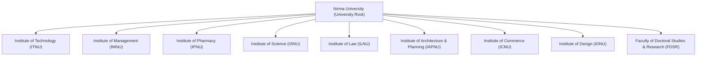
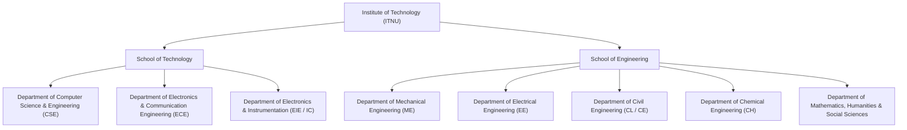
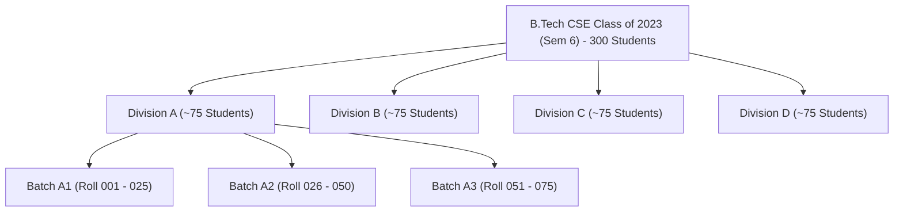
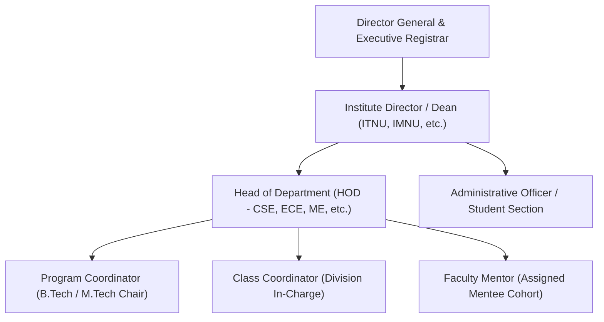

# Nirma University Academic Hierarchy & Data Scoping Architecture
**Document Reference:** `docs/NIRMA_UNIVERSITY_ACADEMIC_HIERARCHY.md`  
**System:** Nirma Calling Assistant  
**Author:** Lead Distributed Systems Architect & Voice AI Specialist  
**Date:** October 2026  
**Status:** Approved Architectural Specification  

---

## 1. Executive Summary

This document specifies the academic, administrative, and student data hierarchy of **Nirma University (Ahmedabad, Gujarat)**. It defines how students, faculty members, academic programs, and departmental units are modeled to guarantee **Attribute-Based Access Control (ABAC)**, strict organizational data isolation, and seamless bulk student data ingestion from university Enterprise Resource Planning (ERP) or Student Information Systems (SIS).

Under this design, an authorized faculty member or departmental operator (e.g., from the *Department of Computer Science & Engineering, Institute of Technology*) can **only search, view, and launch calling campaigns to students enrolled in their own academic scope**, while university-level leadership (Deans, Directors, Registrar) maintains global administrative visibility.

---

## 2. University Academic Structure & Constituent Institutes

Nirma University, established under Gujarat Act No. 10 of 2003 and accredited with a NAAC 'A+' grade, operates across constituent institutes with dedicated academic disciplines:



### 2.1 Constituent Institute Overview
| Institute Code | Institute Name | Established | Degree Programs Offered |
| :--- | :--- | :---: | :--- |
| **ITNU** | Institute of Technology | 1995 | B.Tech, M.Tech, MCA, Ph.D. |
| **IMNU** | Institute of Management | 1996 | MBA (FT), Integrated BBA-MBA, BBA (Hons), Ph.D. |
| **IPNU** | Institute of Pharmacy | 2003 | B.Pharm, M.Pharm (Pharmaceutics/Pharmacology), Ph.D. |
| **ISNU** | Institute of Science | 2004 | M.Sc. (Biotechnology, Microbiology, Biochemistry), Ph.D. |
| **ILNU** | Institute of Law | 2007 | B.A. LL.B. (Hons), B.B.A. LL.B. (Hons), LL.M., Ph.D. |
| **IAPNU** | Institute of Architecture & Planning | 2014 | B.Arch, B.Plan, M.Arch, Ph.D. |
| **ICNU** | Institute of Commerce | 2016 | B.Com. (Hons), Ph.D. |
| **IDNU** | Institute of Design | 2017 | B.Des (Communication Design, Industrial Design) |
| **FDSR** | Faculty of Doctoral Studies & Research | 2003 | Central University Ph.D. Registry & Defense |

---

## 3. Institute of Technology (ITNU) Deep Dive

The **Institute of Technology (ITNU)** is the largest constituent institute of Nirma University and is divided into two academic schools and seven degree-granting departments:



### 3.1 Departmental Programs & Degree Tracks
1. **Department of Computer Science & Engineering (CSE)**
   * **Undergraduate (UG)**:
     * B.Tech in Computer Science and Engineering (NBA Tier-I Accredited)
     * B.Tech in CSE (Artificial Intelligence & Machine Learning)
     * Integrated B.Tech (CSE) + MBA (5-Year Program)
   * **Postgraduate (PG)**:
     * M.Tech in Computer Science and Engineering (Specializations in *Data Science* and *Cyber Security*)
     * Master of Computer Applications (MCA - 2-Year Track)
   * **Doctoral**: Ph.D. in Computer Science and Engineering
2. **Department of Electronics & Communication Engineering (ECE)**
   * **UG**: B.Tech in Electronics and Communication Engineering (NBA Tier-I)
   * **PG**: M.Tech in VLSI Design; M.Tech in Embedded Systems
   * **Doctoral**: Ph.D. in Electronics & Communication
3. **Department of Electrical Engineering (EE)**
   * **UG**: B.Tech in Electrical Engineering (NBA Tier-I)
   * **PG**: M.Tech in Electrical Power Systems / Power Electronics
   * **Doctoral**: Ph.D. in Electrical Engineering
4. **Department of Mechanical Engineering (ME)**
   * **UG**: B.Tech in Mechanical Engineering (NBA Tier-I)
   * **PG**: M.Tech in CAD/CAM, Thermal Engineering, Design Engineering
   * **Doctoral**: Ph.D. in Mechanical Engineering
5. **Department of Civil Engineering (CL / CE)**
   * **UG**: B.Tech in Civil Engineering (NBA Tier-I)
   * **PG**: M.Tech in Construction Technology & Management, Structural Engineering
   * **Doctoral**: Ph.D. in Civil Engineering
6. **Department of Chemical Engineering (CH)**
   * **UG**: B.Tech in Chemical Engineering (NBA Tier-I)
   * **PG**: M.Tech in Chemical Engineering
   * **Doctoral**: Ph.D. in Chemical Engineering

---

## 4. Student Identification & Roll Number Taxonomy

Nirma University enforces an alphanumeric 8-character roll number format across all undergraduate, postgraduate, and doctoral students:

$$\mathbf{[Admission\ Year\ (2\ Digits)] + [Program/Branch\ Code\ (3\ Letters)] + [Sequential\ Index\ (3\ Digits)]}$$

```
Example: 21BCE045
  ││   │││   │││
  ││   │││   └── Serial student number in cohort (Student #045)
  ││   └───── Program code (BCE = B.Tech Computer Science & Engineering)
  └────────── Admission year (2021)
```

### 4.1 Official Program Roll Code Reference Table
| Discipline / Track | Level | Code | Example Roll No | Institutional Email Address |
| :--- | :---: | :---: | :--- | :--- |
| **B.Tech Computer Science & Engineering** | UG | `BCE` | `21BCE045` | `21bce045@nirmauni.ac.in` |
| **B.Tech CSE (AI & Machine Learning)** | UG | `BAI` | `23BAI012` | `23bai012@nirmauni.ac.in` |
| **B.Tech Information Technology** | UG | `BIT` | `20BIT015` | `20bit015@nirmauni.ac.in` |
| **B.Tech Electronics & Communication** | UG | `BEC` | `22BEC102` | `22bec102@nirmauni.ac.in` |
| **B.Tech Electrical Engineering** | UG | `BEE` | `23BEE023` | `23bee023@nirmauni.ac.in` |
| **B.Tech Mechanical Engineering** | UG | `BME` | `20BME091` | `20bme091@nirmauni.ac.in` |
| **B.Tech Civil Engineering** | UG | `BCL` | `22BCL092` | `22bcl092@nirmauni.ac.in` |
| **B.Tech Chemical Engineering** | UG | `BCH` | `20BCH005` | `20bch005@nirmauni.ac.in` |
| **B.Tech Instrumentation & Control** | UG | `BIC` | `21BIC014` | `21bic014@nirmauni.ac.in` |
| **M.Tech Computer Science & Engineering** | PG | `MCE` | `23MCE008` | `23mce008@nirmauni.ac.in` |
| **Master of Computer Applications** | PG | `MCA` | `24MCA015` | `24mca015@nirmauni.ac.in` |
| **Master of Business Administration** | PG | `MBA` | `22MBA104` | `22mba104@nirmauni.ac.in` |
| **B.A. LL.B. (Hons)** | UG | `BAL` | `21BAL055` | `21bal055@nirmauni.ac.in` |
| **B.Pharm** | UG | `BPH` | `22BPH030` | `22bph030@nirmauni.ac.in` |
| **Ph.D. Scholar** | Doc | `PHD` | `24PHD003` | `24phd003@nirmauni.ac.in` |

### 4.2 Automated Regular Expression Parser
The backend ingest utility extracts student attributes directly from their roll number:
```python
import re

NIRMA_ROLL_REGEX = re.compile(r"^(?P<year>\d{2})(?P<branch>[A-Z]{3})(?P<index>\d{3})$")

def parse_nirma_roll(roll_number: str) -> dict:
    match = NIRMA_ROLL_REGEX.match(roll_number.strip().upper())
    if not match:
        raise ValueError(f"Invalid Nirma roll number format: '{roll_number}'")
    data = match.groupdict()
    return {
        "admission_year": 2000 + int(data["year"]),
        "program_code": data["branch"],
        "student_serial": int(data["index"]),
        "official_email": f"{roll_number.lower()}@nirmauni.ac.in",
    }
```

---

## 5. Cohort Partitioning: Divisions & Laboratory Batches

To manage instructional delivery, large student intakes are systematically partitioned into smaller administrative cohorts:



* **Semesters**: Sem 1 to 8 (B.Tech 4-Year), Sem 1 to 10 (Law, Architecture 5-Year), Sem 1 to 4 (M.Tech, MBA, MCA 2-Year).
* **Division**: Managed by a **Class Coordinator** (faculty member) who handles academic notices, timetable adjustments, and attendance reviews.
* **Lab Batch**: Subdivided practical cohort for laboratory sessions, project mentoring, and internal viva examinations.

---

## 6. University Administrative Hierarchy & Governance Roles

Operational and communication authority flows through six distinct administrative levels:



### 6.1 Role Clearance Matrix
| Role Name | Scope Identifier | Permitted System Actions |
| :--- | :--- | :--- |
| **Super Admin / Registrar** | Global (`institution_id`) | Launch university-wide emergency/fee campaigns, inspect all call logs, view global telemetry, provision staff accounts. |
| **Institute Dean / Director** | `institute_id` (e.g. ITNU) | Launch institute-wide campaigns, view cross-departmental analytics within the institute. |
| **Head of Department (HOD)** | `department_id` (e.g. CSE) | Create campaigns for any program or semester in their department, inspect all departmental call logs and student records. |
| **Program Coordinator** | `program_id` (e.g. B.Tech CSE) | Launch campaigns targeting all batches within their specific degree curriculum. |
| **Class Coordinator** | `division_id` (e.g. Sem 6 Div A)| Launch attendance and examination reminders to their assigned division. |
| **Faculty Mentor** | `mentor_id` | Call and review transcripts for their 15–20 assigned mentee students. |
| **Operator** | `department_id` | Student section staff executing batch calls under HOD or Dean delegation. |

---

## 7. Relational Database Schema (SQLAlchemy 2.0 & PostgreSQL DDL)

To implement this hierarchy without data duplication or circular references, the relational schema models universities, institutes, departments, programs, batches, divisions, and students as a normalized cascade:

```sql
-- 1. Constituent Institutes
CREATE TABLE institutes (
    id SERIAL PRIMARY KEY,
    code VARCHAR(20) UNIQUE NOT NULL,               -- 'ITNU', 'IMNU'
    name VARCHAR(150) NOT NULL,                      -- 'Institute of Technology'
    director_name VARCHAR(100),
    contact_email VARCHAR(100),
    is_active BOOLEAN DEFAULT TRUE NOT NULL
);

-- 2. Academic Departments
CREATE TABLE departments (
    id SERIAL PRIMARY KEY,
    institute_id INT NOT NULL REFERENCES institutes(id) ON DELETE RESTRICT,
    code VARCHAR(20) NOT NULL,                      -- 'CSE', 'ECE', 'ME'
    name VARCHAR(150) NOT NULL,                      -- 'Computer Science & Engineering'
    hod_name VARCHAR(100),
    hod_email VARCHAR(100),
    is_active BOOLEAN DEFAULT TRUE NOT NULL,
    CONSTRAINT uq_institute_dept UNIQUE (institute_id, code)
);

-- 3. Academic Programs
CREATE TABLE academic_programs (
    id SERIAL PRIMARY KEY,
    department_id INT NOT NULL REFERENCES departments(id) ON DELETE RESTRICT,
    code VARCHAR(20) NOT NULL,                      -- 'BCE', 'BAI', 'MCE'
    name VARCHAR(150) NOT NULL,                      -- 'B.Tech in Computer Science and Engineering'
    level VARCHAR(20) NOT NULL,                      -- 'UG', 'PG', 'INTEGRATED', 'DOCTORAL'
    duration_semesters INT NOT NULL CHECK (duration_semesters BETWEEN 2 AND 10),
    is_active BOOLEAN DEFAULT TRUE NOT NULL,
    CONSTRAINT uq_dept_program UNIQUE (department_id, code)
);

-- 4. Academic Batches (Cohorts)
CREATE TABLE academic_batches (
    id SERIAL PRIMARY KEY,
    program_id INT NOT NULL REFERENCES academic_programs(id) ON DELETE RESTRICT,
    admission_year INT NOT NULL,                     -- 2021
    graduating_year INT NOT NULL,                    -- 2025
    name VARCHAR(50) NOT NULL,                       -- 'Batch of 2021-2025'
    is_current BOOLEAN DEFAULT TRUE NOT NULL,
    CONSTRAINT uq_program_batch UNIQUE (program_id, admission_year)
);

-- 5. Academic Divisions
CREATE TABLE academic_divisions (
    id SERIAL PRIMARY KEY,
    batch_id INT NOT NULL REFERENCES academic_batches(id) ON DELETE CASCADE,
    code VARCHAR(10) NOT NULL,                      -- 'A', 'B', 'C'
    name VARCHAR(50) NOT NULL,                       -- 'Division A'
    current_semester INT NOT NULL CHECK (current_semester BETWEEN 1 AND 10),
    is_active BOOLEAN DEFAULT TRUE NOT NULL,
    CONSTRAINT uq_batch_division UNIQUE (batch_id, code)
);

-- 6. Students
CREATE TABLE students (
    id SERIAL PRIMARY KEY,
    institute_id INT NOT NULL REFERENCES institutes(id),
    department_id INT NOT NULL REFERENCES departments(id),
    program_id INT NOT NULL REFERENCES academic_programs(id),
    batch_id INT NOT NULL REFERENCES academic_batches(id),
    division_id INT REFERENCES academic_divisions(id),
    mentor_id INT REFERENCES staff_users(id),
    roll_number VARCHAR(20) UNIQUE NOT NULL,        -- '21BCE045'
    name VARCHAR(100) NOT NULL,
    phone VARCHAR(15) NOT NULL,                     -- E.164 (+919876543210)
    alt_phone VARCHAR(15),                          -- Parent emergency phone
    language_pref VARCHAR(10) DEFAULT 'hi' NOT NULL,-- 'en', 'hi', 'gu'
    semester INT NOT NULL CHECK (semester BETWEEN 1 AND 10),
    lab_batch VARCHAR(10),                          -- 'A1', 'A2', 'A3'
    pending_fee_inr NUMERIC(10, 2) DEFAULT 0.00 NOT NULL,
    attendance_pct NUMERIC(5, 2) DEFAULT 100.00 NOT NULL,
    is_active BOOLEAN DEFAULT TRUE NOT NULL,
    created_at TIMESTAMPTZ DEFAULT clock_timestamp() NOT NULL,
    updated_at TIMESTAMPTZ DEFAULT clock_timestamp() NOT NULL
);
CREATE INDEX idx_students_roll ON students(roll_number);
CREATE INDEX idx_students_dept_sem ON students(department_id, semester, is_active);
CREATE INDEX idx_students_phone ON students(phone);
```

---

## 8. Attribute-Based Access Control (ABAC) Enforcement

To enforce that a CSE faculty member never sees or dials Pharmacy, Management, or Civil Engineering students, the application implements **dual-gate security**:

### Gate 1: FastAPI Dependency Scoping (`backend/api/students.py`)
```python
@router.get("/search", response_model=List[StudentSearchResult])
async def search_students(
    q: str = Query(..., min_length=2),
    session: AsyncSession = Depends(get_async_session),
    current_user: StaffUser = Depends(get_current_user),
) -> List[StudentSearchResult]:
    stmt = select(Student).where(Student.is_active.is_(True))

    # ABAC Scoping
    if current_user.role != "super_admin":
        if current_user.department_id:
            stmt = stmt.where(Student.department_id == current_user.department_id)
        elif current_user.institute_id:
            stmt = stmt.where(Student.institute_id == current_user.institute_id)

    term = f"%{q.strip()}%"
    stmt = stmt.where(
        or_(
            Student.name.ilike(term),
            Student.roll_number.ilike(term),
            Student.phone.ilike(term),
        )
    ).limit(10)

    res = await session.execute(stmt)
    return [StudentSearchResult.model_validate(s, from_attributes=True) for s in res.scalars().all()]
```

### Gate 2: PostgreSQL Row-Level Security (RLS)
Guarantees absolute data isolation at the database layer even against SQL injection or direct connection leaks:
```sql
ALTER TABLE students ENABLE ROW LEVEL SECURITY;

CREATE POLICY rls_students_scoping ON students
    FOR ALL
    USING (
        current_setting('app.current_user_role', true) = 'super_admin'
        OR (
            current_setting('app.current_user_role', true) = 'dean'
            AND institute_id = NULLIF(current_setting('app.current_institute_id', true), '')::INT
        )
        OR (
            current_setting('app.current_user_role', true) IN ('hod', 'operator')
            AND department_id = NULLIF(current_setting('app.current_department_id', true), '')::INT
        )
        OR (
            current_setting('app.current_user_role', true) = 'faculty_mentor'
            AND mentor_id = NULLIF(current_setting('app.current_user_id', true), '')::INT
        )
    );
```

---

## 9. Verification & Future Data Ingestion Roadmap

1. **ERP / SIS CSV Import Pipeline**: Future student lists exported from Nirma University's administration portal (TCS iON / MyNirma) can be uploaded as bulk `.csv` files.
2. **Auto-Populating Fields**: The parser extracts `year`, `program_code`, and `index` from the `roll_number` column, maps it to the relational `academic_programs` and `academic_batches` tables, and provisions the record with zero manual data entry.
3. **Audit Trail**: Every batch dialing action logs to `academic_audit_log`, recording the initiating faculty member's ID, department scope, timestamp, and target recipient count for full administrative accountability.
