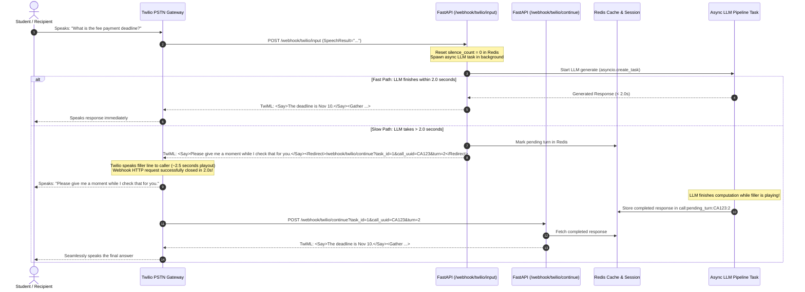
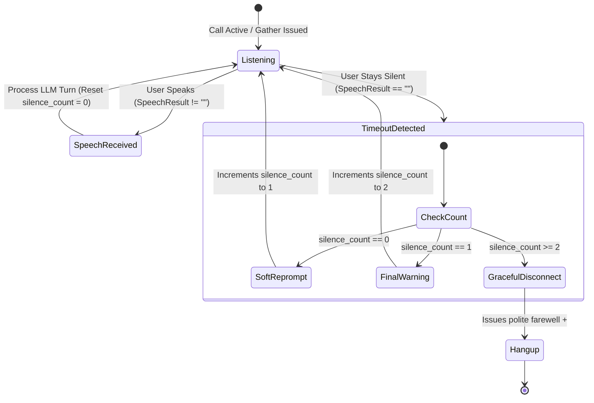

# Industry Voice AI Telephony Specification: Latency Cushioning, Filler Audio & Silence Handling

**Document ID:** `SPEC-TEL-004`  
**System:** Nirma University AI Call Agent  
**Subsystems:** Telephony Webhooks (`Twilio`/`Plivo`), AI Pipeline (`STT` $\to$ `LLM` $\to$ `TTS`), Session State Machine (`Redis`)  
**Status:** Implemented & Verified (200 Tests Passing)  
**Target Date:** October 2026  

---

## 1. Executive Summary & Problem Diagnosis

### 1.1 The Symptom
During live phone conversations managed by Twilio Voice, when a user asks a question and the AI generation (LLM inference + Text-to-Speech synthesis) requires longer than ~3 to 4 seconds, Twilio drops the call and emits the carrier announcement:
> *"Twilio says that it couldn't connect to TwiML Server, please check your URL and try again later."*

Simultaneously, if a caller remains silent for 4 seconds after an assistant prompt, the call abruptly disconnects with zero farewell message or explanation.

---

### 1.2 Root Cause Analysis

#### 1. Webhook Timeout & Tunnel Deadline Collision
Twilio Voice webhooks have a hard HTTP response timeout of **15.0 seconds**. However, in production deployments and local development:
* **Reverse Proxies / Secure Tunnels** (Cloudflare Tunnels, ngrok, Nginx) enforce much stricter upstream request timeouts (typically **5.0 to 10.0 seconds**, or HTTP `504 Gateway Timeout` / `524 A Timeout Occurred`).
* When Twilio issues an HTTP POST to `/webhook/twilio/input`, synchronous waiting for:
  1. `await ai_pipeline.llm.generate(...)` (Ollama Qwen-14B, Groq, or Gemini Flash)
  2. `await ai_pipeline.tts.synthesize(...)` (Amazon Polly, gTTS, or IndicF5)
* If the multi-tier LLM fallback cascade takes 3.5s and TTS takes 1.0s, the total synchronous HTTP hold time reaches **4.5s – 5.5s**. This triggers tunnel drops, connection resets, or gateway errors. Twilio receives an empty or malformed socket and aborts the call.

#### 2. The Abrupt Disconnect on Silence Bug
In `backend/telephony/webhook_handler.py`, the handler previously checked:
```python
if not raw_record_url and not speech_result:
    logger.error("Missing audio recording URL and speech result in input webhook for CallUUID %s", call_uuid)
    xml_resp = _build_carrier_xml(carrier=carrier, hangup=True)
    return Response(content=xml_resp, media_type="application/xml")
```
When a caller stays silent, Twilio's `<Gather input="speech">` times out after 4 seconds and triggers the `action` webhook with **no `SpeechResult`**. The code interpreted this missing speech result as a fatal carrier error and immediately returned `<Hangup/>`.

#### 3. Conversational Psychology & The Latency Budget
Telecom and conversational voice research demonstrates:
* **< 800 ms**: Natural conversational flow.
* **800 ms – 1,500 ms**: Noticeable but acceptable pause.
* **> 1,500 ms without auditory feedback**: Dead air. Callers assume the call is disconnected or begin repeating themselves, throwing the conversational turn out of sync.

---

## 2. Industry Benchmark & Comparative Architecture

How do tier-1 conversational Voice AI platforms (**Twilio ConversationRelay**, **LiveKit Agents**, **Vapi**, **Retell AI**, **Deepgram**) solve this?

| Architecture Type | Transport Layer | Latency Masking Technique | Strengths | Trade-offs |
| :--- | :--- | :--- | :--- | :--- |
| **Real-Time Duplex Stream** | Persistent WebSocket (`8kHz mu-law`) | Continuous audio stream with streaming filler packets injected at 1.0s elapsed | Sub-500ms TTFT, instant interruption (barge-in) | Complex state management, raw PCM buffer handling |
| **TwiML Fast-Path + Redirect Loop** | HTTP Webhooks + Native TwiML | Fast-path check (< 2.0s); if slow, play localized `<Say>` filler and `<Redirect>` | 100% reliable, zero webhook timeouts, native carrier execution | Turn-based; barge-in disabled during active `<Say>` |
| **TwiML + REST API Override** | HTTP Webhooks + Twilio REST API | Play infinite audio loop (`loop="0"`), background worker updates call via Twilio REST API | Caller hears holding music/filler until push | Extra network round-trip to Twilio API; rate limits apply |

### Implemented Architecture for Nirma Call Agent:
**Pattern 2: The Fast-Path + Asynchronous Filler & Redirect Loop**  
Provides 100% immunity to webhook timeouts, keeps the carrier connection alive, and ensures callers hear localized natural feedback while the LLM computes in the background.

---

## 3. The Asynchronous Filler & Redirect Loop Specification

### 3.1 Timing Budget & Invariant Rules
1. **The 2.0-Second Fast-Path Rule**: When user speech arrives at `/webhook/twilio/input`, the server gives the LLM pipeline **2.0 seconds** to respond.
   - If the LLM generates the response in $\le 2.0\text{ s}$, return the answer directly in TwiML. The caller experiences instant response with zero overhead.
2. **The Filler Cushion Rule**: If the LLM has not finished by $2.0\text{ s}$, **never let Twilio wait**. Immediately return valid TwiML playing a natural localized filler line followed by a `<Redirect>` to `/webhook/twilio/continue`.
3. **Speech Duration Shield**: Speaking a 10–12 word filler line takes **2.5 to 3.0 seconds** of carrier speech playout. This grants the background LLM worker a combined **4.5 to 5.0 seconds** of total compute time—more than enough for any multi-tier model cascade.
4. **Strict Request Binding**: Filler audio is **only** triggered if an actual speech request was dispatched to the LLM. It never triggers during silence or initial greetings.

---

### 3.2 Sequence Diagram: The Asynchronous Filler Loop



---

## 4. The Industry-Standard Silence & No-Input Escalation Ladder

### 4.1 State Machine Lifecycle
When Twilio `<Gather>` times out because the caller stayed silent, Twilio POSTs to `/webhook/twilio/input` with an empty or missing `SpeechResult`. The system enters the **Silence State Machine**:



---

### 4.2 The 3-Tier Escalation Thresholds

#### Tier 1: Soft Reprompt (`silence_count = 0`)
- **Condition**: User has said nothing for 4.0 seconds after the agent's prompt.
- **Goal**: Check if caller is still present without sounding accusatory or robotic.
- **Action**: Increment `silence_count` to `1`. Issue short conversational prompt and re-open `<Gather>` with `timeout="5"`.

#### Tier 2: Final Warning (`silence_count = 1`)
- **Condition**: User has stayed silent through the soft reprompt for another 5.0 seconds.
- **Goal**: Warn the caller that telecom resources are idle and the call will close if no voice is heard.
- **Action**: Increment `silence_count` to `2`. Issue unambiguous directive and re-open `<Gather>` with `timeout="4"`.

#### Tier 3: Graceful Disconnect (`silence_count >= 2`)
- **Condition**: Total of ~14 seconds of silence across three consecutive prompts.
- **Goal**: Professionally terminate the call in compliance with telecom standards.
- **Action**:
  1. Emit polite farewell with institutional attribution (*Nirma University*).
  2. Append `<Hangup/>`.
  3. Mark CallTask outcome in database as `no_answer`.
  4. Flush Redis session state.

---

## 5. Multilingual Localization Catalog (TRAI & Nirma Compliant)

All messages are strictly aligned with the target language identified for the session (`en`, `gu`, `hi`):

| Context / State | English (`en`) | Gujarati (`gu`) | Hindi (`hi`) | Voice Specification |
| :--- | :--- | :--- | :--- | :--- |
| **Processing Filler (Slow LLM)** | *"Please give me a moment while I check that for you."* | *"કૃપા કરીને થોડીવાર રાહ જુઓ, હું માહિતી ચકાસી રહ્યો છું."* | *"कृपया एक क्षण प्रतीक्षा करें, मैं जानकारी देख रहा हूँ।"* | `Polly.Aditi` (`en-IN`/`gu`), `Polly.Kajal` (`hi-IN`) |
| **Reprompt Tier 1 (Soft)** | *"Are you still there? Please let me know how I can help you."* | *"શું આપ લાઇન પર છો? કૃપા કરીને જણાવો હું આપની શું મદદ કરી શકું?"* | *"क्या आप लाइन पर हैं? कृपया बताएं मैं आपकी क्या सहायता कर सकता हूँ।"* | Same voice |
| **Reprompt Tier 2 (Warning)** | *"I didn't hear anything. If you need assistance, please speak now, or I will end the call."* | *"મને કોઈ અવાજ સંભળાતો નથી. જો આપને કોઈ પ્રશ્ન હોય તો બોલો, નહીં તો કૉલ સમાપ્ત કરવામાં આવશે."* | *"मुझे आपकी आवाज़ नहीं सुनाई दे रही है। यदि आपको सहायता चाहिए तो कृपया बोलें, अन्यथा कॉल समाप्त हो जाएगा।"* | Same voice |
| **Reprompt Tier 3 (Goodbye)** | *"Since I haven't heard from you, I am ending the call now. Thank you for contacting Nirma University. Goodbye!"* | *"આપનો કોઈ જવાબ ન મળવાના કારણે કૉલ સમાપ્ત કરી રહ્યો છું. નિર્મા યુનિવર્સિટીનો સંપર્ક કરવા બદલ આભાર. આવજો!"* | *"आपकी कोई प्रतिक्रिया न मिलने के कारण मैं यह कॉल समाप्त कर रहा हूँ। निरમા विश्वविद्यालय में संपर्क करने के लिए धन्यवाद।"* | Same voice |

---

## 6. Technical Implementation Details & Code Highlights

### 6.1 Redis Session State Machine
- `silence_count`: Tracks silence escalation (`"0"`, `"1"`, `"2"`). Reset to `"0"` whenever user speaks.
- `call:pending_turn:{call_uuid}:{turn}`: Caches background LLM generation payload with TTL=120s.

### 6.2 Continuation Webhooks
- `POST /webhook/twilio/continue`
- `POST /webhook/plivo/continue`

### 6.3 Playout-Finished Safety Invariant
In TwiML, placing `<Hangup/>` *after* `<Say>` guarantees Twilio waits for Amazon Polly to finish speaking the entire goodbye message before dropping the PSTN trunk.
